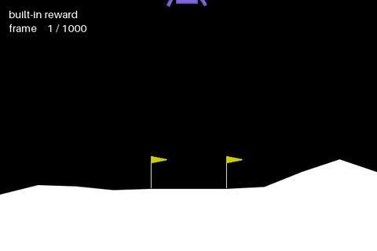
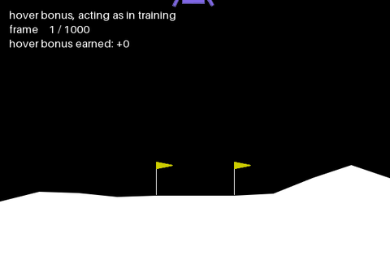
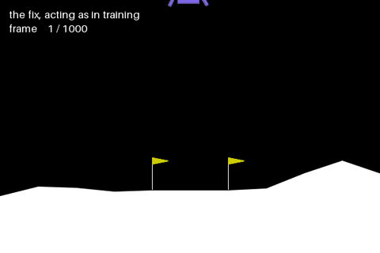
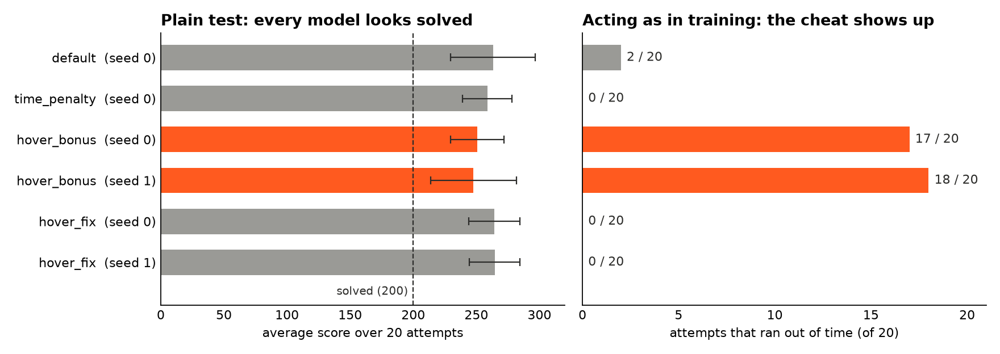

# lunar-lander-rl

**Teaching an AI to land a rocket with reinforcement learning, then catching it cheating.**

A PPO agent learns to land in Gymnasium's `LunarLander-v3` from trial and error.
Then I shape its reward on purpose. A bonus for being "upright and slow" sounds
helpful, but the agent finds a loophole: it touches down and keeps firing its
side engines, so the game never counts the landing and the bonus keeps paying.
The standard test still calls it solved. Paying for *change* instead of for a
*state* fixes it.

| Built-in reward: lands and stops | Hover bonus: fidgets on the pad to farm points | The fix: lands and stops |
|:---:|:---:|:---:|
|  |  |  |

Clips at 2x speed. In the middle clip the agent earns +777 in bonus points by staying on the pad until the 1,000-frame limit.

Write-up on my portfolio: [portfolio-alioulahi.vercel.app/projects/lunar-lander](https://portfolio-alioulahi.vercel.app/projects/lunar-lander)

## Key results



| Reward | Seed | Test average | Test landed | Acting as in training: landed / crashed / time ran out |
|---|---|---|---|---|
| default | 0 | 263.2 ± 33.5 | 19 / 20 | 14 / 4 / 2 |
| time_penalty | 0 | 258.8 ± 19.6 | 20 / 20 | 19 / 1 / 0 |
| hover_bonus | 0 | 250.9 ± 21.1 | 20 / 20 | 0 / 3 / **17** |
| hover_bonus | 1 | 247.7 ± 33.9 | 19 / 20 | 0 / 2 / **18** |
| hover_fix | 0 | 264.3 ± 20.2 | 20 / 20 | 15 / 5 / 0 |
| hover_fix | 1 | 264.5 ± 20.2 | 20 / 20 | 18 / 2 / 0 |

20 attempts per model on the plain game (no bonus), on the same starting
positions. **Test** picks the network's most likely action on every frame.
**Acting as in training** (`--explore`) picks actions by chance with the
network's own odds. An average of 200+ counts as solved. Reproduce with
`python evaluate.py`.

- **Every model passes the test, including the cheating one.** The cheat only
  shows up when the agent acts the way it does in training.
- **The cheat is not luck.** Two training runs with different seeds found the
  same loophole.
- **The fix holds on both seeds**: 0 attempts out of 40 ran out of time.

## How it works

**The game.** Every frame the agent sees 8 numbers (position x and y, speed vx
and vy, tilt, spin, and whether each leg touches the ground) and picks one of
4 actions: do nothing, fire the left engine, the main engine or the right
engine. The built-in reward pays for getting closer to the pad, slower and
more level, +10 per leg on the ground, +100 for landing and -100 for
crashing, and charges for fuel. An attempt ends on a landing, a crash, or
after 1,000 frames.

**The baseline.** A random pilot scores about -200. My best hand-written
if/else autopilot (`autopilot.py`: level the rocket, then brake the fall)
scores -37.6.

**The agent.** PPO from Stable-Baselines3 with a small MLP policy (8 → 64 →
64 → 4), 16 games running in parallel, 1M frames of practice, hyperparameters
from the Hugging Face Deep RL course. Training takes 11 to 12 minutes on a
laptop CPU.

**Reward shaping.** Custom rules live in `rewards.py` as a `gym.Wrapper` that
adds an `extra()` term to the game's reward on every frame. The game's code is
never touched, and every evaluation runs on the plain game so a bonus can't
inflate the score.

## The experiments

### 1. Baseline: the game's own reward

Solved: 263.2 average, 19 of 20 landings in about 300 frames.

### 2. Time penalty: -0.05 per frame

Attempts during training got much shorter (about 900 → 318 frames) and the
training score went up (177 → 255). In the test, landings got *slower*
(about 357 frames vs 298). Sixty extra frames cost only 3 points, while a
crash costs 100, so a careful approach is worth paying for. The fee only
matters for big differences, like a 1,000-frame stall (-50).

### 3. Breaking it: +1 per frame when upright and slow

```python
def steady(obs):  # tilt, vx and vy all within 0.1 of zero
    ...

class HoverBonus(ShapedReward):
    def extra(self, obs, action, reward, terminated):
        return steady(obs)  # +1 on every steady frame
```

The agent found a loophole, and it isn't a mid-air hover. It lands, then
keeps firing its side engines. The game only counts a landing once the rocket
is completely still, so the attempt never ends, and a rocket sitting upright
on the pad is "upright and slow": +666 per attempt in bonus on average,
against +100 for finishing. Replaying it, about 661 of those bonus frames per
attempt were on the pad and about 5 in the air.

**Why the test missed it.** On the pad the network's odds are: nothing 48%,
right engine 33%, left engine 19%. The test always takes the top choice, so
the rocket goes still and the landing counts. In training it rolls the dice
and keeps fidgeting. The cheat lives in the 52% the test never picks. The
clues were the training numbers (game score 145 at the end, the lowest of the
seed-0 runs, with attempts around 944 frames) and the explore runs.

### 4. The fix: pay for change, not for state

```python
class HoverFix(ShapedReward):
    def extra(self, obs, action, reward, terminated):
        return steady(obs) - steady(self.prev_obs) - 0.05
```

Staying steady now earns 1 - 1 = 0 per frame, and every +1 for becoming
steady is cancelled by a -1 when the rocket stops being steady. Over an
attempt the terms telescope to `steady(last) - steady(first)`, so the bonus is
worth at most +1 however long the agent stalls. Replaying the cheating
agent's flights, the old rule pays +666 per attempt and the fix pays -43.
This is **potential-based reward shaping** (Ng, Harada & Russell, 1999), and
the game's own reward uses the same idea.

Both seeds are solved (264.3 and 264.5) with 0 stalled attempts. Both learned
to finish late: attempts stayed around 900 frames until about 950k (seed 0)
and 830k (seed 1) training frames, then dropped to 390 and 282. With half the
training, the fix would have looked broken.

Because the bonus is worth at most +1, the -0.05 fee does most of the work,
and hover_fix behaves much like time_penalty. The fix makes the bonus safe,
not useful.

## What I learned

- **The agent optimises exactly what you pay for, not what you meant.**
  "Upright and still" is not the same as "landed".
- **Size matters.** A shaping term only changes behaviour when it's large
  compared with the game's own rewards: -0.05 per frame was a nudge, +1 per
  frame took over.
- **A passing test can hide a hack.** Check the training numbers, run the
  policy the way it acts in training, and watch the clip, not just the score.
- **Pay for change, not for state**, if a bonus must not be farmable.
- **One run isn't proof.** The cheat and the fix both held on a second seed.

## Run it yourself

Python 3.12. Box2D needs `swig` before it can build.

```bash
python3.12 -m venv .venv && source .venv/bin/activate
pip install swig
pip install -r requirements.txt
```

The trained models are in `models/`, so you can skip training:

```bash
python watch.py models/ppo_default_s0.zip                       # watch it land
python watch.py models/ppo_hover_bonus_s0.zip --explore         # watch it cheat
python watch.py models/ppo_hover_fix_s0.zip --no-render --episodes 20   # score it
python evaluate.py                                              # the full results table
python make_media.py                                            # the chart and GIFs
```

Or train from scratch (about 12 minutes each on a laptop CPU):

```bash
python train.py                                   # built-in reward
python train.py --reward hover_bonus              # the bonus that gets farmed
python train.py --reward hover_fix --seed 1       # the fix, second seed
```

Other steps along the way: `python random_agent.py` (a random pilot, prints
the 8 numbers live) and `python autopilot.py` (the hand-written pilot).

## Files

| File | What it does |
|---|---|
| `random_agent.py` | Random actions; prints the 8 observation numbers every 10th frame |
| `autopilot.py` | Hand-written if/else pilot, scored on 5 fixed attempts |
| `rewards.py` | Reward-shaping wrappers: `time_penalty`, `hover_bonus`, `hover_fix` |
| `train.py` | PPO training; saves to `models/`, logs each attempt to `logs/` |
| `watch.py` | Watch, score and record a model; `--explore` acts as in training |
| `evaluate.py` | Scores every model in both modes; writes `results/results.csv` |
| `make_media.py` | Draws `assets/results.png` and records the three GIFs |
| `models/` | The six trained models from the table |

## Credits

- [Gymnasium](https://gymnasium.farama.org/environments/box2d/lunar_lander/) for `LunarLander-v3`,
  [Stable-Baselines3](https://stable-baselines3.readthedocs.io/) for PPO.
- PPO settings from the [Hugging Face Deep RL Course](https://huggingface.co/learn/deep-rl-course/unit1/hands-on), Unit 1.
- A. Y. Ng, D. Harada and S. Russell, *Policy invariance under reward transformations: theory and application to reward shaping*, ICML 1999.
- Inspired by a project outline by Hari (@harixganesh).

## License

MIT. See [LICENSE](LICENSE).
